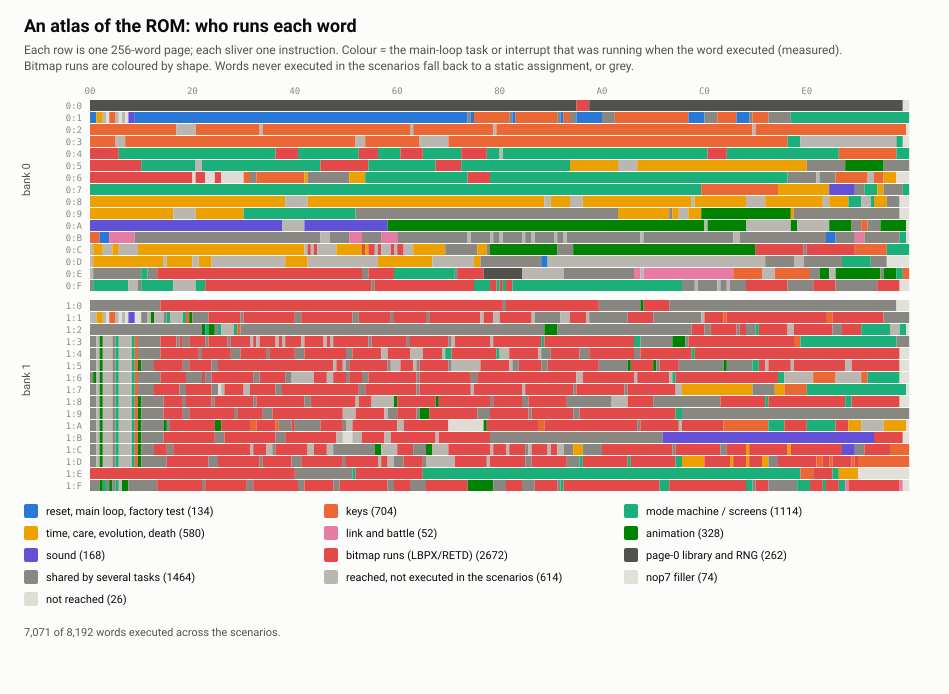

# Digimon V-Pet (1997) — a literate disassembly

**[Read the article → `article/README.md`](article/README.md)**

A long-form walk through the firmware of Bandai's original *Digital Monster* virtual pet
(Ver. 1, with Ver. 2 compared alongside): an Epson E0C6200 4-bit microcontroller, 8,192
twelve-bit instructions, nibble-wide memory, a 32 × 16 dot LCD, three buttons and one metal
prong. It covers the memory maps, the super-loop and its interrupts, how display RAM
becomes pixels, the mode machine that is the whole user interface, timekeeping, injury and
death, the dice, the link protocol, the exact battle odds, the factory test, and what
happens to the old playground cheats.

<picture>
  <source media="(prefers-color-scheme: dark)" srcset="article/figures/rom_atlas-dark.svg">
  
</picture>

Every claim in the article is tagged **measured** (observed by running the ROM in an
emulator, or checked mechanically), **read** (inferred from the code) or **documented**
(from a named outside source).

## What is here

| Path | |
|---|---|
| `article/` | the article, its appendices (every subroutine, RAM, I/O) and its figures |
| `tools/static/` | control-flow walker, a disassembler with three fixes, an assembler for the lossless round trip, subsystem classifier, name tables |
| `tools/emulation/` | headless driver for BrickEmuPy's E0C6200 core, a two-unit link cable with tamper hook, trace harness (coverage, memory access, task attribution, mode transitions, screens), the experiments, and a script that rebuilds every saved state from power-on |
| `tools/figures/` | the figure and appendix generators |
| `ghidra/` | headless Ghidra 12 scripts for the E0C6S46 processor module: seed and export, then apply the recovered map |
| `data/` | small derived data: the battle threshold table, the LCD layout, the Ver.1/Ver.2 alignment |
| `roms/` | checksums only |

## No ROM here

Bandai's firmware is not distributed. Bring your own dump; `roms/SHA256SUMS` lists the
images this work was done against. Full machine listings reproduce the ROM byte for byte, so
they are generated locally into `generated/` and never committed. The article quotes short
excerpts only.

## Thanks

To azya52 for [BrickEmuPy](https://github.com/azya52/BrickEmuPy), whose emulator and LCD
faces made all of the measuring possible; to Veryyes for the
[E0C6S46 Ghidra module](https://github.com/Veryyes/E0C6S46-Ghidra-Processor); to BladeSabre
and the [DMComm](https://dmcomm.github.io/) project for the link protocol and the care
mechanics; and to humulos and NHOKO for the growth charts.
