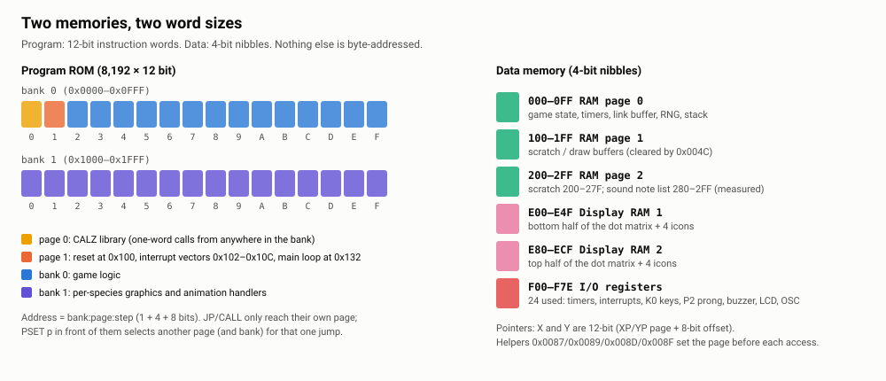
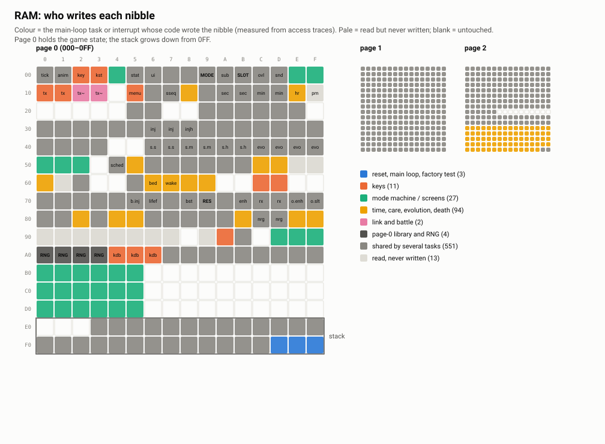
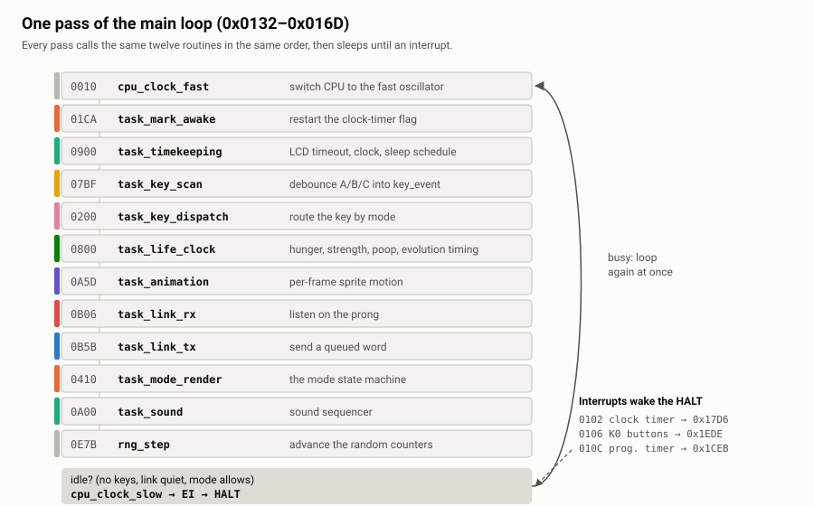
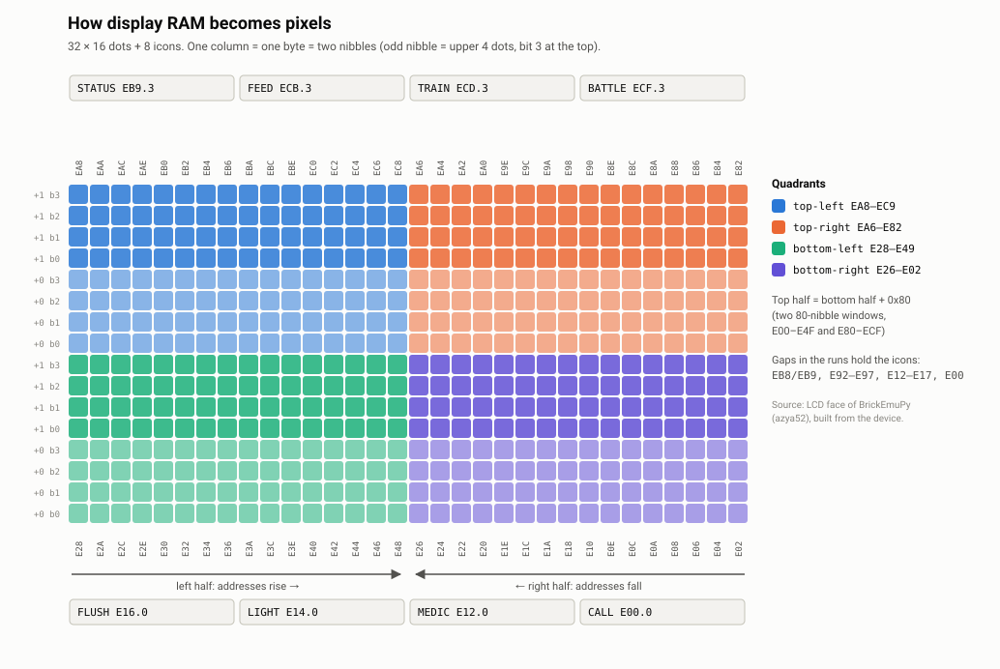
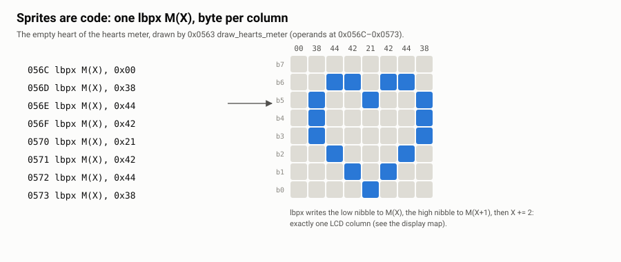
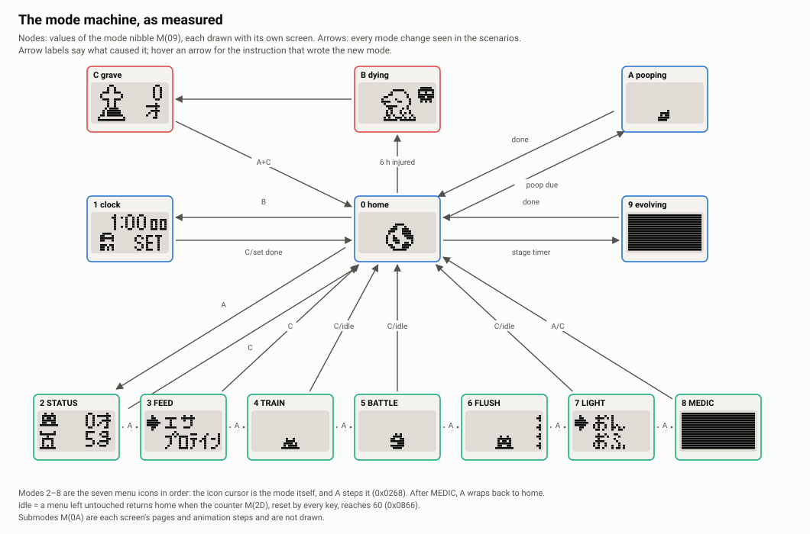
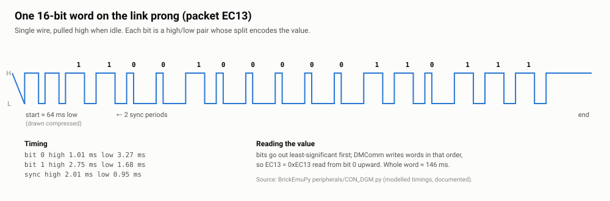
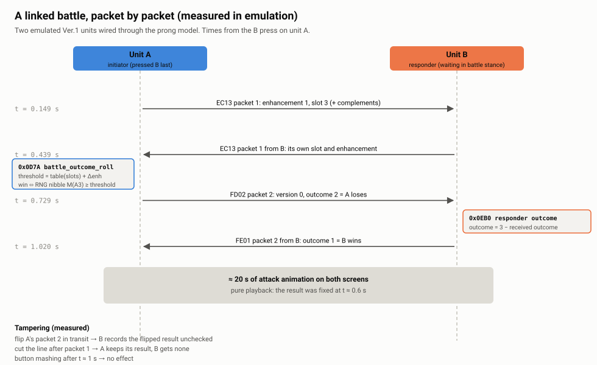
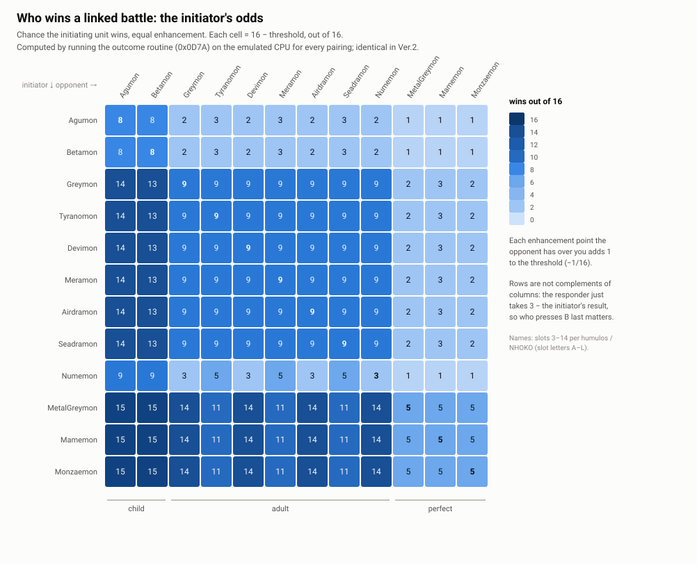
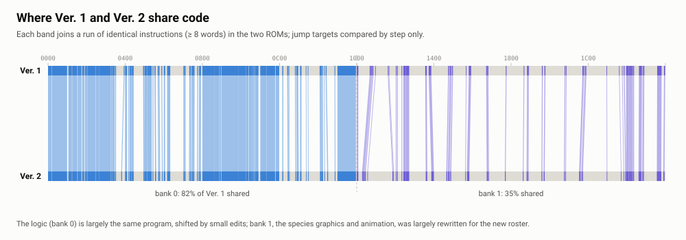

# Inside the 1997 Digimon V-Pet

### A literate disassembly of Bandai's *Digital Monster* Ver. 1 firmware

> In 1997 every playground had a rule: kill your Digimon, then press **A** two hundred
> times, **B** two hundred times and **C** twenty-five times, and a flaming Teddymon
> comes back. Nobody ever saw it happen. Twenty-nine years later the mask ROMs have been dumped,
> the CPU has an emulator, and the question can be put to the program itself.

This is a long walk through that program: 8,192 twelve-bit instructions running on a
4-bit Epson microcontroller, with nibble-wide memory, a 32 × 16 dot LCD, three buttons,
a buzzer and one metal prong for fighting. It is written to be read in order, the way
Knuth meant literate programs to be read: the machine first, then the loop that drives
everything, then each subsystem as the loop reaches it. Short excerpts of the machine code
appear where they carry the argument; the ROM itself is not here (see
[Reproducing this](#reproducing-this)).

Every claim is tagged with how it is known:

- **measured** — observed by running the ROM: an emulated unit driven headless, two units
  linked through a model of the prong, memory and I/O traces with the program counter that
  made each access, or a mechanical check such as byte-identical reassembly;
- **read** — inferred from reading the code and not separately exercised;
- **documented** — taken from a named outside source (Epson's manuals, BrickEmuPy,
  DMComm, humulos/NHOKO).

---

## Contents

1. [The machine](#1-the-machine)
2. [How it was read](#2-how-it-was-read)
3. [An atlas of the ROM](#3-an-atlas-of-the-rom)
4. [Power on](#4-power-on)
5. [The loop that runs everything](#5-the-loop-that-runs-everything)
6. [Page zero: a library you can call in one word](#6-page-zero-a-library-you-can-call-in-one-word)
7. [Pixels](#7-pixels)
8. [Three buttons](#8-three-buttons)
9. [The mode machine](#9-the-mode-machine)
10. [Time, care and death](#10-time-care-and-death)
11. [The dice](#11-the-dice)
12. [One wire](#12-one-wire)
13. [Battles](#13-battles)
14. [The factory test](#14-the-factory-test)
15. [The playground rumours, settled](#15-the-playground-rumours-settled)
16. [Ver. 1 against Ver. 2](#16-ver-1-against-ver-2)
17. [The community's guide, checked](#17-the-communitys-guide-checked)
18. [Notes on the tools](#18-notes-on-the-tools)
19. [Reproducing this](#reproducing-this)
20. [Appendices](#appendices)

---

## 1. The machine

The V-Pet is built around a member of Epson's **E0C6200** family of 4-bit
microcontrollers, the same core that runs the first-generation Tamagotchi
(**documented**: Epson *E0C6200 Core CPU Manual*; BrickEmuPy runs the Digimon ROMs on its
`E0C6200` core at 1.06 MHz). Three facts about this core shape everything that follows.

**Program words are 12 bits wide; data is 4 bits wide.** The ROM holds 8,192 instruction
words. Data memory is addressed in *nibbles*: there is no byte anywhere in the data
path, so an 8-bit quantity is two adjacent nibbles and the code adds them with carry by
hand. The dumps store each 12-bit word in a 16-bit big-endian slot; the top nibble is zero
in every word of both dumps (**measured**).

**The program counter is split into bank, page and step.** An address is one bank bit,
four page bits and eight step bits: 2 banks × 16 pages × 256 words. Jumps and calls carry
only the 8-bit step, so on their own they stay inside the current page. To leave the page,
a `PSET p` instruction placed immediately in front of the jump names the destination bank
and page for that single jump. The firmware is therefore full of two-word pairs like
`pset 0x0B / call 0B06`. One exception matters a great deal: **`CALZ`** ("call zero")
always lands on page 0 of the current bank in a single word, and Bandai used it to build a
small shared library there (§6).

**Memory pointers are 12 bits, assembled from a page and an offset.** Registers X and Y
are each a 4-bit page (XP, YP) plus an 8-bit offset; `M(X)` is "the nibble X points at".
Before touching I/O the code points XP at page F, before touching game state it points
XP at page 0, and four tiny page-0 helpers exist to do exactly that.

<picture>
  <source media="(prefers-color-scheme: dark)" srcset="figures/address_spaces-dark.svg">
  
</picture>

Data memory as this firmware uses it (**measured** from access traces):

| Range | What lives there |
|---|---|
| `000–0FF` | game state: mode, species slot, clock, timers, link buffer, dice, stack |
| `100–1FF` | scratch and draw buffers |
| `200–2FF` | scratch, and from `280` up, the note list the sound interrupt plays |
| `E00–E4F`, `E80–ECF` | display RAM: the bottom and top halves of the dot matrix, plus 8 icons |
| `F00–F7E` | I/O: of the registers the core defines, the firmware touches 24 |

The traces reach address `2FF`, so this chip has 768 nibbles of RAM rather than the
Tamagotchi part's 640.

---

## 2. How it was read

Four instruments, each checking the others.

1. **An emulator, driven without a screen.** BrickEmuPy (azya52) already runs these ROMs.
   Its core was wrapped in a headless harness that presses buttons, holds them during
   reset, renders the LCD to text or PNG, and records every program counter executed and
   every memory access with the program counter that made it. A second harness wires two
   units together through BrickEmuPy's model of the prong so that battles happen between
   two emulated devices, with a hook to drop or alter packets in transit.
2. **Ghidra 12**, headless, with the community E0C6S46 processor module (Veryyes), whose
   instruction set matches this core.
3. **A purpose-built control-flow walker** that follows the paging rules exactly as the
   emulator's core executes them, resolves `JPBA` jump tables (including an idiom that
   doubles the index into a 16-entry, 32-word table of two-word entries), and handles `RETS`, which
   returns past the instruction after the call.
4. **A reassembler** built by inverting the disassembler. If the annotated listing
   reassembles to the identical ROM, no bit of the ROM was lost in the text. That proves
   the listing is complete. It does not prove every mnemonic is right, because the
   assembler inverts the same tables; the meanings were checked separately against the
   emulator core, Epson's manual and execution.

What each found, for Ver. 1:

| Measure | Result |
|---|---|
| Words decoded and reassembled byte-identically | **8,192 / 8,192** (Ver. 1 and Ver. 2) — measured |
| Words reached by the walker | **8,092 / 8,192**; 74 of the other 100 are `nop7` filler — measured |
| Words actually executed across the scenarios | **7,071 / 8,192** — measured |
| Words Ghidra's auto-analysis covers on its own (both vector tables seeded) | **4,799 / 8,192** — measured |
| Executed words Ghidra alone leaves undefined | **2,602**; with the recovered map applied, **0** — measured |
| Executed words the walker missed before being seeded with the trace | **69** — measured |
| Subroutines (`CALL`/`CALZ` targets plus interrupt vectors, both banks' tables) | **288** — measured |

The scenarios: power-on and reset; hatching and a baby's first hour; menus, feeding,
training and the light; six hours of neglect; a night with the clock wound to bedtime; a
linked battle in each role and a broken link; death and the grave; the factory test,
including the link self-test between two units; every button held during reset; and every
species slot forced in turn and allowed to reach its next evolution.

The round trip paid for itself early. It caught two bugs in BrickEmuPy's
*disassembler* (not its emulation, which is correct): `CP YL,i` printed as `ADC YL,i`, and
`DEC M(n)` printed as `INC M(n)`, now reported upstream. Ghidra's gap is
almost entirely `JPBA`: a computed jump it cannot follow, which hides the species dispatch
table and nearly all of bank 1 behind it. Details in §18.

---

## 3. An atlas of the ROM

Before reading any routine, it helps to see the whole program at once. Every one of the
8,192 words below is coloured by **who ran it**: the main-loop task or interrupt that was
executing when that instruction executed, recorded across all the scenarios
(**measured**). Runs of the bitmap-writing instructions are coloured by shape instead, and
words the scenarios never reached fall back to a static assignment or grey.

<picture>
  <source media="(prefers-color-scheme: dark)" srcset="figures/rom_atlas-dark.svg">
  
</picture>

Three things are visible before reading a single instruction:

- **Bank 0 is the program; bank 1 is mostly pictures.** Bitmap runs cover
  2,308 of bank 1's 4,096 words (56%) and 364 of bank 0's (9%).
- **Page 0 is the shared library** (dark), and page 1 begins with the vectors and the main
  loop.
- **Logic is clustered by task.** The key handling (pages 2 and 3), the screens (4 to 7) and
  the life clock (8 and 9) each occupy recognisable stretches of bank 0, because Bandai laid
  the code out page by page and reached across pages with `PSET`. The link code on page B
  shows mostly as shared: the battle screens call its routines directly as well as through
  the link tasks.

The RAM tells the same story from the other side (**measured** from access traces): each
nibble coloured by the task with the most instructions that write it. A nibble a page-0
helper writes counts for every task that called the helper, so the decimal counters, which
are all bumped through `bcd_inc_mod60`, come out mixed. Even so, the layout shows through:
the injury count and hours, the next-evolution time and the poop timer (`36`, `3A`,
`4C`–`4F`, `80`–`82`) are the life task's, the battle
state and result at `78`–`7D` the link and battle code's, the debounce at `A4`–`A6` the
key scan's, and `B0`–`B5` a buffer of the screens. Nothing above `B5` is game state:
`B6`–`DF` are only ever cleared, and the stack uses `E3`–`FF`.

<picture>
  <source media="(prefers-color-scheme: dark)" srcset="figures/ram_map-dark.svg">
  
</picture>

The named variables are listed in [Appendix B](appendix-ram.md).


---

## 4. Power on

Execution starts at bank 0, page 1, step 0 (`0x0100`), which jumps over the interrupt
vectors to `0x010E`. What follows is the whole of initialisation (**read**, and every line
**measured** as executed on power-up):

```asm
010E  rst F, 0x0          ; clear flags
010F  ld A, 0x0
0110  ld SPL, A           ; stack pointer = 0x00; the first push lands at 0xFF
0111  ld SPH, A
0112  callz 0007          ; cpu_clock_slow
0113  ld A, 0x0 / ld B, 0x2 / callz 0022    ; zero 000-0DF; the stack at 0E0-0FF survives
0116  callz 0010          ; cpu_clock_fast
0117  ld A, 0x1 / ld B, 0x0 / callz 0022    ; zero all of page 1, then all of page 2
011D  ld A, 0xE / ld B, 0x2 / callz 0022    ; zero E00-EDF: the whole display
0120  callz 0087          ; XP = F (I/O)
0121  ld X, 0x10 / lbpx M(X), 0x04          ; EIT (F10) = 4: enable the 2 Hz timer interrupt
0123  ld X, 0x71 / lbpx M(X), 0x80          ; LCD control (F71) = 0, contrast (F72) = 8
0125  ld X, 0x40 / ld A, M(X)               ; read the buttons (K0)
0127  and A, 0x7
0128  cp A, 0x3           ; exactly A held (active low: 011)?
0129  jp z, 016E          ;   -> factory test
...
0130  callz 00ED
0131  ei
0132  ...                 ; the main loop
```

Two details are worth noticing. The stack pointer starts at `00` and the first push wraps
to `FF`, so the stack grows down from the top of page 0 — which is why the very first
clear stops at `0DF`: it is called from inside a subroutine whose return address is
already sitting at `0FD`–`0FF`. And the factory test is not a
hidden menu: it is the very first decision the program makes, on the very first read of
the buttons.

---

## 5. The loop that runs everything

There is no operating system and no scheduler. From `0x0132` the program calls the same
twelve routines in the same order, forever (**read**; **measured** as the hot path in
every scenario):

<picture>
  <source media="(prefers-color-scheme: dark)" srcset="figures/super_loop-dark.svg">
  
</picture>

```asm
0132  callz 0010          ; cpu_clock_fast
0133  call 01CA           ; task_mark_awake
0134  pset 0x09 / call 0900   ; task_timekeeping
0136  pset 0x07 / call 07BF   ; task_key_scan
0138  pset 0x02 / call 0200   ; task_key_dispatch
013A  pset 0x08 / call 0800   ; task_life_clock
013C  pset 0x0A / call 0A5D   ; task_animation
013E  pset 0x0B / call 0B06   ; task_link_rx
0140  pset 0x0B / call 0B5B   ; task_link_tx
0142  pset 0x04 / call 0410   ; task_mode_render
0144  pset 0x0A / call 0A00   ; task_sound
0146  pset 0x0E / call 0E7B   ; rng_step
0148  ...                 ; anything pending? -> jp 0132
015B  di
...   callz 0007          ; cpu_clock_slow
016B  ei
016C  halt
016D  jp 0132
```

After the twelfth call the loop checks whether anything is still in flight: a key not yet
consumed, a link transfer, a mode that animates continuously. If so it goes straight round
again. If not, it drops the CPU back to its slow oscillator, enables interrupts and
**halts**. The chip then sleeps until one of three interrupts wakes it
(**read**, each handler **measured** as executed):

| Vector | Handler | Job |
|---|---|---|
| `0102` | `17B9` | **Heartbeat.** Reads the timer's 2 Hz factor and turns it into flags in `M(00)`: bit 0 on every tick (the animation frame), bit 3 flipping each half-second, bits 1–2 set once a second. The clock and the animation count these flags. |
| `0106` | `1AC6` | **Key wake.** Acknowledges the button interrupt, disables it, and returns. It does no work; it exists only to end the `HALT` so the loop can scan the keys. |
| `010C` | `1BB3` | **Sound player.** Driven by the programmable timer: walks a note list in RAM from `280`, reloads the timer for each note, and switches the buzzer off at the end. |

### Two vector tables, because `RET` forgets the bank

The handlers live in bank 1, and the E0C6200's `RET` restores the page and step but **not
the bank**. An interrupt that arrives while bank-0 code is running pushes a bank-0 return
address; if the bank-1 handler simply returned, execution would resume at the right step in
the wrong bank. The core also vectors into page 1 of *whichever bank is executing*
(`PC = bank | 0x100 | vector` in the emulator's core), and Bandai used both facts:

```asm
; bank 0 vector table                 ; bank 1 vector table
0102  pset 0x17 / jp 17D6             1102  pset 0x17 / jp 17B9   ; heartbeat body
0106  pset 0x1E / jp 1EDE             1106  pset 0x1A / jp 1AC6   ; key-wake body
010C  pset 0x1C / jp 1CEB             110C  pset 0x1B / jp 1BB3   ; sound body

17D6  call 17B9           ; bank-0 path: run the body as a subroutine inside bank 1,
17D7  pset 0x00           ;   then jump to a RET that lives in bank 0,
17D8  jp 000F             ;   so the final return lands in the right bank
```

An interrupt taken in bank 1 goes straight to the body, whose own `RET` already returns
within bank 1. An interrupt taken in bank 0 goes through a three-instruction trampoline that
borrows the `RET` at `0x000F`, the last instruction of `cpu_clock_slow`. Both tables
execute in the scenarios (**measured**); the static walker missed the bank-1 table until
the trace pointed at it.

The design is a classic low-power super-loop. The interesting consequence comes in §11:
the dice advance once per pass of this loop, so anything that makes the loop run more
passes — pressing a button, an animation — moves the dice.

---

## 6. Page zero: a library you can call in one word

Because `CALZ` reaches page 0 in a single instruction from anywhere in the bank, page 0 is
where the small, hot helpers live: 44 subroutines, 36 of them called from more than one
place (**measured** from the call graph). The busiest, `0089`, is called from 53 sites. The
ones that explain the rest of the code:

| Address | Name | What it does |
|---|---|---|
| `0007` / `0010` | `cpu_clock_slow` / `cpu_clock_fast` | switch the CPU between the 32 kHz and fast oscillators (`F70`) |
| `0022` | `clear_ram_blocks` | zero 16-nibble blocks from the start of page A until B wraps past F; B = 0 clears the whole page |
| `002A` / `0033` | `bcd_inc_mod60` / `bcd_dec_mod60` | two-digit decimal counters that wrap at 60: minutes |
| `0039` | `hour12_inc` | the hour counter, 1 to 12 |
| `007C` | `bcd_inc_sat99` | a decimal counter that sticks at 99 |
| `0087` `0089` `008D` `008F` | page setters | XP = F (I/O), XP = YP = 0, XP = 1, XP = 2 |
| `00A8` / `00C2` | `prog_timer_start` / `_stop` | start or stop the sound interrupt |
| `00E7` | `is_battle_ready_screen` | Z set when mode 5, step 2 |
| `00F8` | `dispatch_page_0F` | a jump table on page F indexed by `M(Y)` |

The decimal helpers tell you how the designers thought: clocks, timers and counters are
kept in binary-coded decimal so that drawing them on the screen needs no division, which a
4-bit CPU with no multiply would have to do by repeated subtraction.

---

## 7. Pixels

### From nibbles to dots

The LCD is a 32 × 16 dot matrix with eight icons around it. The mapping from display RAM
to dots is the single most useful thing to know when reading this firmware
(**documented** from the LCD face in BrickEmuPy, which its author built from the device):

<picture>
  <source media="(prefers-color-scheme: dark)" srcset="figures/display_map-dark.svg">
  
</picture>

Each column of eight dots is one byte, stored as two adjacent nibbles with the higher
nibble on top and bit 3 at the very top. The top half of the screen lives in the second
display window at exactly the same offsets as the bottom half, plus `0x80`. Within each
half the left sixteen columns *ascend* through memory and the right sixteen *descend*,
meeting in the middle — an artefact of how the LCD's segment lines are wired to the
controller. The eight icons occupy the gaps the column runs skip.

### Sprites are code

The E0C6200 has an instruction made for this layout: `LBPX M(X), byte` writes the low
nibble of an 8-bit immediate to `M(X)`, the high nibble to `M(X+1)`, and advances X by
two. One `LBPX` is one column. So the graphics are not stored as data that a blitter
reads; they are stored as *instructions that draw themselves*. Point X at a column of
display RAM, call the routine, and eight `LBPX` instructions paint an 8 × 8 tile
(**read**; the result **measured** on screen):

<picture>
  <source media="(prefers-color-scheme: dark)" srcset="figures/sprite_columns-dark.svg">
  
</picture>

The same trick explains `RETD l`, an instruction that returns from a subroutine *and*
writes an 8-bit immediate to `M(X)` and `M(X+1)` on the way out. A routine can end on the
last column of its sprite for free. About a third of the ROM is shaped like this
(see the atlas in §3), most of it in bank 1.

### One handler per species

Bank 1 is organised around the species. At `0x1230` the code reads the growth-chart slot
`M(0B)`, doubles it, and jumps through a 32-word table at `0x1200` made of sixteen
two-word `pset`/`jp` pairs (**read**; the walker needed a dedicated rule for this idiom):

```asm
1230  ld A, M(0xB)        ; species slot 0..15
1231  ld B, 0x0
1232  rcf
1233  rlc A               ; A = slot * 2 (low nibble), carry -> B
1234  rlc B
1235  ld X, 0xD2
1236  jpba                ; jump to 0x1200 + B:A
...
1200  pset 0x1C / jp 1C94  ; slot 0 (egg)
1202  pset 0x12 / jp 12B8  ; slot 1
1204  pset 0x13 / jp 1310  ; slot 2
...
121E  pset 0x1E / jp 1E48  ; slot 15
```

Fifteen distinct pages serve the sixteen slots; only the egg (slot 0) and slot 13 share
one.

---

## 8. Three buttons

The buttons are bits 2, 1 and 0 of the input port `K0` at `F40`, active low (**documented**,
BrickEmuPy device configuration). They are never read in an interrupt. The key-wake
interrupt only ends the `HALT`; the reading happens in the main loop, in
`task_key_scan` at `0x07BF` (**read**; presses **measured** to register at hold times from 80 to 200 ms):

```asm
07C2  ld Y, 0x40          ; YP = F, so M(Y) = K0
07C3  ld A, M(Y)
07C4  xor A, 0xF          ; active low -> active high
07C5  and A, 0x7          ; A=4, B=2, C=1
07C6  ld X, 0xA4
07C7  cp M(X), A          ; same as the last sample?
07C8  jp z, 07CC
07C9  ldpx M(X), A        ; no: remember it (A4), reset the count (A5),
07CA  ldpx M(X), 0x0      ;     and mark a change pending (A6)
07CB  or M(X), 0x1
07CC  ld X, 0xA6
07CD  fan M(X), 0x1       ; change pending?
07CE  jp z, 07D6
07CF  ld X, 0xA5
07D0  add M(X), 0x1       ; count stable passes
07D1  cp M(X), 0x3
07D2  jp c, 07D6
07D3  ld X, 0xA6          ; three in a row: accept
07D4  and M(X), 0xE
07D5  ld M(0x2), A        ; key_event = A
07D6  ret
```

A new button state is accepted after it has been seen on three consecutive passes of the
main loop. The accepted state goes into `key_event` at `M(02)`, and every screen reads
keys only from there. Note where the debounce state lives: `A4`–`A6`, right next to the
dice at `A0`–`A3`.

`task_key_dispatch` at `0x0200` then routes the event by mode. Its very first decision
is the one that settles the playground rumour (§15):

```asm
0243  cp B, 0x9           ; B = mode
0244  jp nc, 0208         ; mode >= 9 (evolving, dying, dead): drop the key
```

---

## 9. The mode machine

The whole user interface is one nibble. `M(09)` holds the **mode**, `M(0A)` the step within
it, and `task_mode_render` at `0x0410` is a switch on the mode (**read**):

```asm
0410  callz 0089
0411  call 0409
0412  ld X, 0x09
0413  ldpx A, M(X)        ; A = mode, X -> submode
0414  cp A, 0x1
0415  pset 0x05 / jp z, 0523    ; 1: clock
0417  cp A, 0x0
0418  jp z, 04E6                ; 0: home
...
041B  cp A, 0x3
041C  jp c, 042C                ; 2: STATUS pages
041D  jp z, 04B3                ; 3: FEED
041E  cp A, 0x5
041F  pset 0x06 / jp c, 0656    ; 4: TRAIN
0421  pset 0x07 / jp z, 0700    ; 5: BATTLE
...
0428  pset 0x05 / jp z, 0577    ; 9: evolving
042A  pset 0x01 / jp 01DB       ; A and up: pooping, dying, grave
```

Every mode change the scenarios produced was recorded, with the instruction that wrote
it (**measured**):

<picture>
  <source media="(prefers-color-scheme: dark)" srcset="figures/mode_machine-dark.svg">
  
</picture>

The design decision that makes the code small is visible in the bottom row: **the menu
cursor is the mode itself.** Modes 2 to 8 are the seven icons in order — STATUS, FEED,
TRAIN, BATTLE, FLUSH, LIGHT, MEDIC — and pressing A on any of them is a single
`add M(X), 1` at `0x0268` (**measured**: every A press in every scenario took this path).
On MEDIC the same addition produces 9, the evolving mode, for exactly two instructions:
`0x0269` compares with 9 and `0x026B` writes 0, so the cursor wraps to home (**measured**;
the figure folds the pair into one arrow). Selecting with B moves into the mode's sub-steps. C goes home, and so does leaving a menu
alone: `0x0866` returns any of modes 2–8 to home when an idle counter at `M(2D)`, cleared
by every key at `0x0222`, reaches 60 (**read**; the transition **measured**).


---

## 10. Time, care and death

### Two clocks

The game keeps two separate times, both counted from the heartbeat flags in `M(00)` by
`task_timekeeping` and `task_life_clock` (**read**; the counters **measured** advancing):

| | Where | Format |
|---|---|---|
| Wall clock | `M(1A–1B)` seconds, `M(1C–1D)` minutes, `M(1E)` hour, `M(1F)` bit 0 = PM | BCD, 12-hour |
| Stage timer | `M(46–47)` seconds, `M(48–49)` minutes, `M(4A–4B)` hours | BCD minutes, 8-bit hours |

The wall clock drives the daily schedule. Once an hour `sleep_schedule_check` at `0x09A0`
compares the hour against two per-species values, a bedtime `M(66)` and a waking hour
`M(67)` — the per-Digimon "awake from … to …" hours that the community charts list
(**documented**: humulos/NHOKO) — and raises the sleep or wake flags in `M(54)`
(**read**; **measured** running on the hour, and writing `M(54)`, in a scenario with the
clock set to 7:58 PM and later to 6:58 AM).

The stage timer drives growth. `M(4C–4F)` holds the stage time at which the next
evolution is due. When the timer reaches it, `0x05AB` sets the mode to 9 and the
evolution animation runs (**measured**: writing a time two minutes ahead into `M(4C–4F)`
made a Koromon evolve two minutes later, and forcing each slot in turn and doing the same
triggered mode 9 for 15 of the 16 slots). Choosing what to become is done on the way, by
the code around `0x0D10` (**read**).

### Injury and death

A battle can leave the Digimon injured: bit 0 of `M(05)` (**measured**: the seventh
consecutive battle between two emulated children injured one). Each battle also takes one
from the counter at `M(8C–8D)` (**measured** across consecutive battles; that it is the
energy the community describes is **read**). An injury left untreated is counted in hours, and at six the code at `0x08D3`
calls `enter_death_sequence` (`0x07D7`), which sets mode B (**measured**: the death
sequence began 360 emulated minutes after the injuring battle, rebuilt from power-on by
`tools/emulation/make_states.py`; and at routine level, injury time 5:59 → 6:00 kills while
4:59 → 5:00 does not):

```asm
08D6  ld X, 0x38
08D7  callz 002A          ; injury minutes (BCD, wraps at 60)
08D8  jp nz, 08EB
08D9  add M(X), 0x1       ; another full hour
08DA  cp M(X), 0x6
08DB  jp c, 08EB
08DC  pset 0x07
08DD  call 07D7           ; six hours untreated: die
```

Mode B plays the dying animation; `0x07E9` then sets mode C, the grave, which stays until
A and C are pressed together (§15).

There are two ways into an injury, and both go through the same routine, `set_injured` at
`0x0510` (**read**):

- **After a battle**, the code at `0x01EC` adds a per-species chance to a second value and
  compares the sum with the dice nibble `M(A3)`; if the dice are at or below it, the Digimon is
  injured.
- **From neglect of the toilet.** `M(07)` counts the piles on screen. A timer at
  `M(80–82)` makes the life clock set mode **A**, a short squatting animation (the scenarios
  caught it three times: **measured**, entered at `0x088B` and left at `0x0CFA`), during which
  `add_poop` at `0x08ED` adds a pile. FLUSH clears the count (`0x04D7`). The count stops at
  eight, and the eighth pile calls `set_injured`. If a poop falls due while the clock or a
  menu is on screen, the pile is added without the animation.

`set_injured` sets the bit, restarts the six-hour clock at `M(38–3A)` if the Digimon was
not already injured, and in every case adds one to a two-digit decimal count at
`M(36–37)`. When that count reaches 20, `0x0521` calls `enter_death_sequence` directly:
a second way to die, by accumulated injuries rather than one untreated injury
(**measured**: with the count at 19, one more injury starts the death sequence; at 18 it
does not).

That makes four ways to die, and all of them were measured (§17):

- six hours injured;
- the twentieth injury in one form;
- a call left unanswered for twelve hours;
- the fifth care mistake after the lifespan has run out.

The lifespan runs out when an adult's or Perfect's final timer passes without an
evolution: `0x0D5F` sets `M(76)` bit 1, and from then on `M(75)` counts care mistakes.

The finer rules of care — how protein moves energy, enhancement and the chance of injury,
how care mistakes subtract — were worked out on real hardware by the DMComm project and
match the variables named here (**documented**: DMComm, *Original V-Pet*).


---

## 11. The dice

Every random decision in the game draws on four nibbles at `A0`–`A3`, advanced by
`rng_step` at `0x0E7B`, the last call of every main-loop pass (**read**; the values
**measured** in traces):

```asm
0E7B  callz 0089
0E7C  ld X, 0xA0
0E7D  sdf                 ; decimal mode on
0E7E  adc M(X), 0x3       ; A1:A0 += 73, in BCD
0E7F  inc X
0E80  adc M(X), 0x7
0E81  rdf                 ; decimal mode off
0E82  ld X, 0xA2
0E83  adc M(X), 0x3       ; A3:A2 += 0x73, in binary
0E84  inc X
0E85  adc M(X), 0x7
0E86  ret
```

It is not a random number generator in any statistical sense. It is two chained counters,
and both of them add a carry. The first instruction is `adc`, and nothing in `rng_step`
clears the carry flag on the way in, so the decimal pair `A1:A0` steps by 73 plus whatever
carry the previous code left behind. The binary pair `A3:A2` then steps by `0x73` plus the
carry out of the decimal add. **Measured:**

- **One pass per heartbeat.** An idle unit makes exactly one pass per heartbeat: 84 calls
  in 42 seconds for an egg, a baby and a child alike (`tools/emulation/rng_rate.py`).
- **The entry carry depends on the state.** The child and the baby entered with the carry
  clear every time, so their decimal step was 73. The egg entered with it set, so its step
  was 74.
- **The binary step follows the decimal wrap.** In a run of 171 consecutive passes from
  a child, the binary step was `0x74` on exactly the 125 passes where the decimal counter
  wrapped past 99, and `0x73` otherwise.

With the carry clear, the decimal counter returns to its start every 100 passes, and by
then the binary counter has moved by 53. 53 shares no factor with 256, so the pair repeats
only after **25,600 passes**, three and a half hours at two passes a second. With the carry
set, the period is **12,800 passes**. Both periods were measured by calling the routine
until it returned to its starting state.

The battle roll reads just `M(A3)`, the top nibble of the binary counter. Nothing about
the dice is random: from a known state, the same inputs at the same moments give the same
results every time. What makes them unpredictable in play is that their state carries the
whole history since power-on, including every extra pass a button press or an animation
caused, and the player can't see it. That is why a sweep of battle start times (§13) finds
the outcome flipping with a few hundred milliseconds' difference in when B is pressed. It is
also why a fixed button sequence, pressed without knowing the dice's current state, can't
aim them.

---

## 12. One wire

Two V-Pets fight through a single metal prong: one open-drain line, pulled high when
idle, that either unit can pull low. The firmware drives and samples it through bit 0 of
port `P2` (`F62`), polled from the main loop by `task_link_rx` at `0x0B06` and
`task_link_tx` at `0x0B5B` (**measured**: every instruction that touches `F62` lies in these routines on page B; the battle screens and the factory test reach the line only by calling into them).

A word is sixteen bits. Each bit is a high/low pair whose split carries the value
(timings **documented** from BrickEmuPy's `CON_DGM` peripheral model; bit order
**measured** against DMComm's notation):

<picture>
  <source media="(prefers-color-scheme: dark)" srcset="figures/link_timing-dark.svg">
  
</picture>

Every word is sent together with its complement: the transmit routine at `0x0B16`
inverts the queued nibbles before sending, so a receiver can reject a corrupted word.
The factory test uses the link layer bare: in its comm screen, pressing A sends `5AA5`
and expects `A55A` back (**measured** between two emulated units: both show "OK!").

---

## 13. Battles

<picture>
  <source media="(prefers-color-scheme: dark)" srcset="figures/battle_sequence-dark.svg">
  
</picture>

A battle is four words (**measured** between two emulated units):

1. The **initiator** — the unit whose B press starts the exchange while the other waits in
   battle stance — sends packet 1: its slot and enhancement (with complements).
2. The responder answers with its own packet 1.
3. The initiator now has everything it needs. `battle_outcome_roll` at `0x0D7A` computes a
   **threshold** from the two slots and the difference in enhancement, compares one nibble
   of the dice against it, and sends packet 2 carrying the *outcome*: 1 for a win, 2 for a
   loss.
4. The responder does not compute anything. At `0x0EB0` it takes `3 − outcome` and sends
   its own packet 2.

Then both screens play twenty seconds of animation whose ending was fixed about 0.6 s
after the button press.

### The threshold

The comparison is `win ⇔ M(A3) ≥ threshold`, so the initiator's chance is
`(16 − threshold) / 16`. Rather than paraphrase the comparison tree at `0x0D7A`, the
routine was executed on the emulated CPU for every pairing of slots (**measured**;
identical in Ver. 2, where the routine sits four words later at `0x0D7E`):

<picture>
  <source media="(prefers-color-scheme: dark)" srcset="figures/battle_odds-dark.svg">
  
</picture>

Three things fall out of the table.

- **Stage dominates.** A child initiating against an adult wins 2 or 3 times in 16; an
  adult against a child 13 or 14. A Perfect against anything below it wins 11 to 15.
- **Enhancement is linear.** Each point of enhancement the opponent has over you adds one
  to the threshold, exactly one sixteenth of a win, clamped at both ends (**measured**:
  from −4 to +4 the threshold for an even child match runs 4, 5, 6 … 12).
- **The table is not symmetric, so it matters who initiates.** If the two rows agreed,
  "A initiates against B" and "B initiates against A" would give complementary odds. They
  often do not. Two adults: whoever initiates wins 9 in 16, either way round. Two Perfects:
  whoever initiates wins only 5 in 16, so the better move is to wait. Agumon against
  Numemon: if Agumon initiates it wins 2 in 16; if Numemon initiates, Agumon wins 7. This is
  the mechanism behind an old forum tip that "it might matter which device you press the
  button on".

### Two slips in the comparison tree

The asymmetry is worth reading closely, because most of it does not come from the shape of
the routine. It comes from two places where the code compares the wrong thing (**read**;
the consequences **measured**).

The routine's idiom is *compare, load, branch*. A `CP` sets the flags, an `LD A, i` loads a
candidate threshold (loads do not touch the flags on this core), and a conditional jump
keeps that threshold or moves on:

```asm
0D81  cp B, 0x5           ; opponent a child?
0D82  ld A, 0x8           ;   candidate threshold 8
0D83  jp c, 0DD3          ;   yes: keep it
0D84  cp A, 0xB           ; opponent Numemon (slot B)?  -- but A now holds 8
0D85  ld A, 0x9
0D86  jp z, 0DD3          ;   never taken
```

The routine opens with `cp A, 0xB` on the *initiator's* slot, which is a real test: a
Numemon initiating gets a branch of its own at `0DC6`. Five more `cp A, 0xB` follow, one on
each branch, each placed where the question being asked is about the *opponent* in
register B — and each comes right after `A` has been overwritten with a threshold constant.
They compare a constant with `0xB` and can never succeed. `cp A, 0xB` is opcode `DCB`;
`cp B, 0xB` is `DDB`. The two differ by one bit.

The second slip is in the adult and Perfect branches. Each ends in `sub A, B` followed by
"equal → threshold 8", the only place outside the child branch where an even fight is
possible. Here too `A` holds a constant by the time the subtraction runs (`0xE`, `0xD` or
`1`), so the equality never happens.

The effect on fights between two of the same Digimon, from the measured table:

| Same species, either unit initiating | Threshold | Initiator wins |
|---|---:|---:|
| child against the same child | 8 | 8 / 16 |
| adult against the same adult | 7 | 9 / 16 |
| Perfect against the same Perfect | 11 | 5 / 16 |
| Numemon against Numemon | 13 | 3 / 16 |

As a what-if, not a claim about the device: patching the five `DCB`s to `DDB` and executing
the routine again (`tools/emulation/threshold.py --patch`; **measured** on the patched ROM)
makes Numemon against Numemon an even 8, and turns 8 more of the 66 pairings of different
Digimon into complementary pairs (19 → 27). Whether Bandai meant any of this is not
something the ROM can say. What it does say is that the table players were fighting was
not the table the comparison tree is shaped to compute, and that both versions shipped
with it: the routine is identical in Ver. 2.

### What tampering does (measured)

The responder trusts packet 2 without checking it against anything:

| Experiment | Initiator | Responder |
|---|---|---|
| Normal battle | loses | wins |
| Flip the initiator's packet 2 in transit | loses | **loses** |
| Cut the line after packet 1 | loses | no result |
| Cut the line before the first reply | no result | no result |
| Mash A/B during the first half second | 3 of 16 timings: both lose; 1: result flips; 2: one side gets none | |
| Mash after about one second | no effect | no effect |

---

## 14. The factory test

Holding A while resetting sends the program to `0x016E` before the main loop ever
starts (§4). It fills the whole of display RAM with ones, then hands over to the test at
`0x09F4` (**measured**):

| Screen | Next key | Purpose (read) |
|---|---|---|
| every dot and icon on | B | find dead segments |
| checkerboard, four of the icons | C | find shorts between neighbouring segments |
| inverse checkerboard, the other four icons | A | the same, inverted; **A also sends `5AA5` on the prong** |
| comm result | — | "OK!" once the partner's `A55A` comes back (**measured** between two units) |

No other button combination held during reset does anything except restart the egg
(**measured**: B, C, A+B, A+C, B+C, A+B+C).

---

## 15. The playground rumours, settled

The 2010 "Digimon Mythbusters" thread on With the Will collected the schoolyard cheats.
Each was tried on the emulated Ver. 1 (**measured**), and the code explains each result.

| Rumour | What happens | Why |
|---|---|---|
| **Flaming Teddymon**: on the grave, A ×200, B ×200, C ×25 | nothing; the screen never changes | the key gate at `0x0243` drops every key while the mode is 9 or above. Comparing the 640 nibbles of RAM below `280` (all game state) after 25, 24 and 26 C presses, after a different press speed and after no presses at all, the only differences were the last key, stack residue and the dice. Nothing counts presses. |
| **Choose your Digimon**: reset, then C ×400 | nothing | the same comparison after 399, 400 and 401 presses: no nibble tracks the count |
| **Sure win**: AAABBBCC in battle | no effect once the battle has started | the result is fixed about 0.6 s after the B press (§13); mashing during the handshake only corrupts it (both lose, no result, or a flip) |
| **Poison your opponent**: ABCAABC | no effect | as above |
| **Shadow battle**: pull the units apart at the last moment | real, and explained | if the line breaks after the initiator has computed the outcome, it keeps its result and the other unit gets none (§13) |
| **Glitch Digimon** from battery tricks | consistent with the code | forcing only the species slot `M(0B)` produces a body that will not battle: a mature sprite with a baby's empty energy, much like the "insta-Teddymon that refuses every command" stories. Real battery-contact glitches corrupt RAM in ways an emulator cannot reproduce faithfully, so this is consistency, not proof. |

And two real things the rumours missed:

- **A + C on the grave** starts a new egg without a reset. The handler at `0x0CEF` checks
  for exactly that pair while the mode is C (**measured**).
- **Holding A at power-on** runs the factory test (§14), the first decision the program
  makes.


---

## 16. Ver. 1 against Ver. 2

Ver. 2 swaps the roster (Punimon, Tsunomon, Gabumon and their lines, per humulos)
but not the machine. Aligning the two instruction streams, with jump targets reduced to
their 8-bit step so that shifted code still matches (**measured**):

<picture>
  <source media="(prefers-color-scheme: dark)" srcset="figures/versions-dark.svg">
  
</picture>

| | Ver. 1 words in identical aligned runs |
|---|---|
| bank 0 (logic) | 3,376 / 4,096 — **82%** |
| bank 1 (species graphics and animation) | 1,436 / 4,096 — **35%** |
| whole ROM | 4,812 / 8,192 — 59%, in 755 runs, the longest 246 words |

The battle outcome routine is the cleanest example. Four words later in Ver. 2 (`0x0D7E`),
its comparison tree is the same instruction for instruction once the jump targets are
relocated by four, both slips of §13 included, and executing it yields the same threshold
table (**measured**). Of the routine's 113 words, 42 differ. Forty are those relocated
branch targets, and two are real changes, both after the roll (**measured**, word by
word). Where Ver. 1 writes `0` beside the result (`0DE5 ldpx M(X), 0x0`) and sends `0` in
the second nibble of packet 2 (`0DE9 ldpx M(X), 0x0`), Ver. 2 loads whatever `M(78)` holds
(`0DE9 ldpx A, M(X)`) and sends that (`0DED ldpx M(X), A`). DMComm documents that
nibble as the device's version: 0 for Ver. 1, 1 for Ver. 2, and a Ver. 1 going second
echoes its opponent's. A constant 0 in Ver. 1 and a stored value in Ver. 2 fit that
description. The two ROMs are one
program with two sets of monsters.

Ver. 2 went through the same static pipeline (**measured**):

| | Ver. 1 | Ver. 2 |
|---|---:|---:|
| Words reassembled byte-identically from the annotated listing | 8,192 | 8,192 |
| Words reached by the walker (no traces) | 8,023 | 8,045 |
| … after seeding with executed PCs | 8,092 | (no Ver. 2 traces) |
| Subroutines | 288 | 267 |
| Words Ghidra decodes on its own / with the map | 4,799 / 8,098 | 4,844 / 8,045 |

The Ver. 2 names are carried over rather than rediscovered. `tools/static/port_names.py`
moves a Ver. 1 name to Ver. 2 when its address lies in an identical aligned run, or, for
a function outside one, when its first eight instructions match exactly one Ver. 2
subroutine. That ports 72 of the 74 named functions and entry points and 9 of the 11
labels. Each is marked `ported`, not measured. The care and evolution rules were measured
on Ver. 2 directly (§17).


## 17. The community's guide, checked

The most complete public reference for these rules is humulos's site: an
[evolution guide](https://humulos.com/digimon/dm/) (requirements, waking hours,
lifespans, an FAQ on care and death) and a [battle chart](https://humulos.com/digimon/dm/battles/).
The site credits the evolution data mainly to NHOKO, and the battle data to fans who took
the device apart, with Kurozatou as the main interpreter. Every checkable claim on those
two pages was put to the firmware here. The method was the same as for the battle table:
poke the inputs into RAM, start the CPU at the routine that decides, and read what it
computed (`tools/emulation/care_rules.py`, `tools/emulation/starvation.py`; all
**measured** unless marked).

The [Digimon Original (Ver.20th) guide](https://humulos.com/digimon/dm20/) on the same
site covers a different device. It is the 2017 re-release, with its own program, and its
Ver. 1 chart deliberately changes the rules. Compared with this ROM, it uses 3 care
mistakes rather than 4 as the branch point and lowers the training thresholds (16 rather
than 32 for Greymon, for example). It drops the sleep-disturbance conditions, has
Botamon evolve after 10 minutes rather than about an hour, and replaces the Perfect roll
with "15 battles, 12–15 victories". Its bedtimes are one to three hours later. The device itself is documented as a
different game too. Its battles are fought with power, attributes and an attack-order
minigame. Every Digimon wakes at 7 AM, and the evolution timer pauses during sleep
(humulos, *Digimon Original manual*; **documented**). A call goes out after 10 minutes,
not 20, and two hearts emptying together count as two care mistakes (Wikimon;
**documented**). This firmware has the 20-minute call and counts one care mistake per call.
What the re-release keeps from 1997 is the link protocol. Its OTHER battle mode "will use
a predetermined slot from the original Digital Monster series", mostly by stage, and
ignores power and attributes. humulos's 1997 battle page notes that when a modern device
initiates, it is the modern device that does the calculation. So the chart below
describes a fight only when a 1997 unit presses first. No dump of the re-release's
program turned up, so how much code, if any, it shares with this ROM is unknown. Its
documented behaviour differs in all the ways above, which is why the 1997 pages are the
ones to check.

### Where the guide and the firmware agree

| Claim on the guide | Checked how | Result |
|---|---|---|
| Battle chart: 12 × 12 initiator win chances | `0x0D7A` executed for every pairing | all 144 cells identical |
| Boost = ⌊max(min(overdoses, 4) + strength hearts − min(care mistakes, 4), 0) / 2⌋ | code at `0x0FB9` | the same formula, instruction for instruction (**read**) |
| Boost difference added to the chance, clamped at 1/16 and 16/16 | `0x0DD3`–`0x0DDE` | yes |
| Evolution requirements (care mistakes, training, overfeed, sleep disturbances) for Koromon, Agumon and Betamon | `0x0D10` executed over 14,112 combinations | every combination picks the Digimon the guide's main entries name |
| Perfect: 15 battles, then a roll at 1/8, 1/4 or 1/2 for a win score of 0–4, 5–8 or 9–15 | `0x0D67` over all win scores and dice | exactly that; with 14 battles, never |
| The roll happens at both the III→IV and IV→V evolutions, either success suffices (75% at best) | qualified bit `M(76).0` survives the III→IV setup | yes |
| Win score +1 per win, −1 per loss, kept within 0–15 | `0x0736`–`0x0741` | yes (**read**) |
| Battles and win score carry over; care mistakes and injuries reset | `0x0C17` with every counter preset | `M(98–99)` kept; `M(31–37)` cleared |
| Waking and sleeping hours of all 13 Digimon | `0x0C17` per slot | all 13 identical |
| A care mistake when a call goes unanswered for 20 minutes | `0x08C3`: the call timer's tens digit reaching 2 | yes (**read**) |
| Death after 6 hours injured | an untreated unit | death sequence 360 minutes after the injury (§10) |
| Death from 5 care mistakes once the lifespan is up | `0x08C8` with `M(76).1` set | the fifth calls `enter_death_sequence`; the fourth does not |

The guide's FAQ wonders whether hunger and strength emptying together count as one care
mistake or two. The code says one. `0x09DC` raises a single call and only starts its
timer if no call is already running; the second empty heart just adds its bit to `M(65)`.
So one unanswered call makes one care mistake (**read**).

### Where they differ

1. **A typo in Betamon's Numemon list.** The guide gives "4+ care mistakes, 8–31 training,
   3+ overfeed, 9+ sleep disturbances" as a route to Numemon, and also "0–3 overfeed, 9+
   sleep disturbances" as the route to Airdramon. The two overlap at exactly 3 overfeeds.
   The firmware sends that case to Airdramon. The Numemon bullet should read 4+ overfeed.
2. **Greymon's lifespan.** The guide says 116 hours. The firmware schedules Greymon's next
   evolution between 120:00 and 127:59 of stage time. The guide's own FAQ table ("44–124
   hours" for Stage IV) is consistent with the firmware, not with the Greymon entry.
3. **Lifespans are windows, not numbers.** `0x0C65` builds the next-evolution time from
   the dice. The minutes come from `M(A0)` and the clock's tens of minutes. The hours are
   a per-species multiple of 16 plus `M(A2) | 8`, which is 8 to 15. Every stage after the
   first therefore ends somewhere in an eight-hour window: 40–48 h for Koromon and
   Numemon; 72–80 h for the children, Tyranomon, Meramon, Seadramon and Mamemon; 104–112 h
   for Devimon, Airdramon, MetalGreymon and Monzaemon; 120–128 h for Greymon. The guide's
   figures are the windows' midpoints. Botamon is the exception. It evolves 50–59
   minutes in, or 60–69 if the dice's tens digit `M(A1)` is 5 or more.
4. **"Getting sick ?? times" is 20 injuries.** The guide lists an unknown number of
   sicknesses as a cause of death. In this firmware every injury goes through
   `set_injured`, whether from a battle or from the eighth pile of poop, and it adds one
   to a decimal count at `M(36–37)`. The twentieth injury in one form starts the death
   sequence: count 19 plus one injury gives mode B, while count 18 plus one does not.
   The FAQ also says "20 Care Mistakes or Injuries" stop an evolution. Care mistakes
   can't. Their counter `M(31)` stops at 15, and no route into the death sequence reads it
   (**read**: there are exactly two ways into the death sequence, `0x0522` and `0x08DD`).
5. **Overdoses count to 15, not 4.** The guide says the overdose count "has a maximum value
   of 4". The counter `M(62)` goes up by one per four proteins and saturates at 15
   (`0x0341`–`0x0347`); only the boost formula caps it at 4. The uncapped count feeds the
   injury roll, which the guide doesn't describe. After every battle, `0x01EC` injures the
   Digimon when the dice `M(A3)` are at or below a per-species base plus the overdose
   count. Writing *s* for base plus overdoses, the chance is (*s* + 1)/16 up to *s* = 14;
   an overflowing sum (16 and up) is capped at a threshold of 14, which is 15/16. The base is 3 for Betamon and
   Numemon; 2 for Agumon, Tyranomon and Seadramon; 1 for Greymon, Devimon, Meramon,
   Airdramon and MetalGreymon; and 0 for Mamemon and Monzaemon. The roll also has a hole.
   When base plus overdoses is exactly 15, `0x01F4` skips it altogether, so an Agumon with
   13 overdoses can't be injured in battle, while one with 12 or 14 is injured 15 times in
   16.
6. **Starving takes 12 hours, not 6.** The guide says a heart left empty for 6
   consecutive hours is fatal. An empty heart raises a call (`0x09DC`), which clears a
   timer at `M(40–43)`. The timer counts minutes, then hours through `hour12_inc`, and
   `0x08BD` starts the death sequence when the hour count reaches 12. An emulated
   Agumon was kept awake with the call running and no button pressed. It died at exactly
   720 minutes, after one care mistake at the 20-minute mark. A second run, with the hour
   count preset to 6, died at 360 minutes. That pins the threshold at a count of 12 with
   the count starting from zero (`data/starvation_v1_*.json`). Whether sleep pauses this
   timer was not tested. The 6 hours may come from the injury rule, which really is six.

### Ver. 2

The same experiments ran on the Ver. 2 ROM, whose deciding routines sit at the same
addresses as in Ver. 1, against the guide's Ver. 2 entries. A freshly reset unit
supplied the RAM image.

- **Agree:**
  - The waking and sleeping hours of all 13 Digimon.
  - The Perfect roll.
  - The 20-injury and old-age deaths.
  - Every evolution choice for Tsunomon and Gabumon.
  - The per-slot injury bases, which are identical to Ver. 1's.
- **Same windows, same slip:**
  - Tsunomon evolves between 32 and 40 hours; the guide says 36.
  - Kabuterimon, in Greymon's slot, evolves between 120 and 128 hours, and the guide says
    116, the same mismatch as Greymon's.
- **Elecmon's training bands are different from the guide's.** The guide sends a neglected
  Elecmon (4+ care mistakes) towards Frigimon (Yukidarumon) with 8–31 training, and
  towards Whamon with 32+. The code splits at 16. In Ver. 1, Betamon's branch tests the
  high nibble of the training count twice, once for "below 16" and once for "exactly
  16–31". Ver. 2's Elecmon branch (`0x0D48`–`0x0D4B`) has only the first test. With
  16–31 training, an Elecmon therefore takes the Whamon route: 6+ overfeeds and 0–4 sleep
  disturbances for Whamon, Vegimon otherwise. Of 4,704 Elecmon combinations tried, 228
  disagree with the guide, all of them in that band.

The battle page already said that the chart "contradicts the official magazine guides"
because "the programmed scenarios" were "not triggering properly", and that Monzaemon was
"certainly intended" to be the strongest. The two slips in §13 are the mechanism behind
that observation. The guide recorded the effect from the device; the code shows why.


---

## 18. Notes on the tools

### Ghidra and the E0C6S46 module

The community module (Veryyes/E0C6S46-Ghidra-Processor) compiles cleanly with Ghidra 12's
SLEIGH compiler and decodes every instruction correctly. Seeded with the reset and
interrupt vectors of both banks' tables, auto-analysis of Ver. 1 covers 4,799 of 8,192
words — 3,603 in bank 0 but only 1,196 in bank 1 — and leaves 2,602 *executed* words
undefined (**measured**; Ver. 2: 4,844 words, and the full comparison for both versions
is in [`ghidra/README.md`](../ghidra/README.md)).

The cause is **`JPBA`**, a computed jump to `B:A` on the current or `PSET` page. Ghidra
cannot know B and A, so everything reached only through the 25 jump tables stays dark:
the per-species table at `0x1200` (and with it most of bank 1), the mode handlers, the
battle state machine. `ghidra/ApplyMap.java` adds the walker's recovered targets as
computed-jump references, names the subroutines, labels and variables, and disassembles the
rest; afterwards Ghidra covers 8,098 words of Ver. 1 and 8,045 of Ver. 2, and no word
the walker reaches, executed or not, is left undefined (**measured**).

Two smaller things are worth knowing if you use the module on other ROMs:

- A `PSET`-prefixed `CALL` keeps the current bank in the module
  (`:CALL s (thisPcb) is ... pprev=1`). That is what Epson's manual specifies (`CALL`:
  `PCP ← NPP, PCS ← s`, with no bank transfer; **documented**), and it matches `RET`, which
  cannot return across banks either. BrickEmuPy's core instead takes the bank from the
  `PSET`, contrary to the manual text quoted in its own comment. This ROM never makes a
  cross-bank call (**measured**: 0 sites). Its 80 cross-bank transfers are all
  `PSET`-prefixed jumps: 43 into bank 1, one of them conditional, and 37 back to bank 0.
  Both the module and the core handle those identically, so here the difference is moot.
- The `rom` space is word-addressed, but Ghidra's `AddressSpace.getAddress(long)` takes a
  *byte* offset: word `0x110` is `getAddress(0x220)`. Address *strings*, such as the
  `.pspec`'s `start` symbol at `rom:0x110`, are already in words; that symbol lands on word
  `0x110` (**measured**), which in this ROM is the third instruction of initialisation
  rather than the reset vector at `0x100`. Scripts that seed or label ROM words from
  numbers must multiply by the addressable unit size (the scripts here do; an earlier
  draft did not, and measured nonsense).

Of the 320 functions Ghidra finds on its own, 193 match the walker's subroutines; 121 of
the other 127 are `JP` targets that Ghidra promotes to functions (61 of them reached by a
`PSET`-prefixed jump from another page), and the last six are jump-table bases and the
entry point. That is a different definition of "function", not a disagreement about code;
this article counts subroutines as `CALL`/`CALZ` targets plus interrupt vectors (288).
With the map applied, all 288 are functions in the Ghidra project too.

### BrickEmuPy's disassembler

The round trip through the reassembler found two display bugs, both in the disassembler
only; the emulation core executes these opcodes correctly (**measured**):

| Opcode | Shown as | Actually | Used by |
|---|---|---|---|
| `A70`–`A7F` | `adc YL, i` | `cp YL, i` (the core's handler is `_cp_yl_i`) | Ver. 1: 8 words, Ver. 2: 6 |
| `F70`–`F7F` | `inc M(n)` | `dec M(n)` | neither ROM |

windwakr's BrickEmuPy issue #41 had pointed at the same lines along with a third bug
(`add r, q` and its siblings printed `r` twice). That third one was fixed upstream on
2026-10-03, before this work cloned the repository; these two are still present at the
current `main` and are reported as
[azya52/BrickEmuPy#42](https://github.com/azya52/BrickEmuPy/issues/42). A related quirk is
not a bug: `RLC r` (`AFx`) encodes its register twice, and the disassembler reads the low
copy, so the non-canonical encodings print as valid `rlc` instructions. Neither ROM uses
one. `tools/static/dasm_fixed.py` patches the two bugs and canonicalises the alias.

### The walker

`tools/static/walker.py` follows the emulator core's paging rules exactly: a `PSET`
affects only the next jump or call and supplies both bank and page; `CALZ` goes to page 0
of the current bank; `RET` restores page and step but never the bank; `RETS` returns one
instruction further, which the walker only follows for callees that can actually execute
`RETS`. `JPBA` targets come from the nearest preceding `ld B, i`, including the
`ld B,0 / rcf / rlc A / rlc B` idiom that builds a doubled, even index into a table of
two-word `pset`/`jp` entries. One table (`0x1E47`) indexes from RAM and is filled in from
the execution trace instead.


---

## Reproducing this

Nothing here contains Bandai's code beyond short excerpts. To rebuild every number and
figure you need your own dump of the Ver. 1 (and optionally Ver. 2) mask ROM; the SHA-256
of the images used is in `roms/SHA256SUMS`.

```sh
git clone https://github.com/azya52/BrickEmuPy
git -C BrickEmuPy checkout 376cca9        # the revision every number here was measured with
export BRICK=$PWD/BrickEmuPy ROM=$PWD/roms/digimon_v1.bin ROM2=$PWD/roms/digimon_v2.bin
export G=$PWD/generated
mkdir -p $G/v1 $G/v2 $G/cov

# 1. saved states and emulation scenarios (coverage, memory traces with the PC of
#    every access, task attribution, mode transitions, screens)
cd tools/emulation
PYTHONPATH=$BRICK python3 make_states.py
for s in boot baby_life child_life night battle death testmode evolve; do
  PYTHONPATH=$BRICK python3 coverage.py $s $G/cov/$s.json $ROM
done
python3 -c "import json,glob; print(json.dumps(sorted({p for f in glob.glob('$G/cov/*.json') \
  for p in json.load(open(f))['pcs']})))" > $G/executed.json
PYTHONPATH=$BRICK python3 threshold.py $ROM ../../data/battle_threshold_v1.json 0D7A
PYTHONPATH=$BRICK python3 threshold.py $ROM2 ../../data/battle_threshold_v2.json 0D7E
PYTHONPATH=$BRICK python3 threshold.py $ROM ../../data/battle_threshold_v1_whatif_cpB.json 0D7A \
  --patch 0D84=DDB 0D96=DDB 0DAC=DDB 0DB9=DDB 0DC9=DDB
PYTHONPATH=$BRICK python3 care_rules.py st_v1_childA.pkl ../../data/care_rules_v1.json
PYTHONPATH=$BRICK python3 -c "import harness,pickle; p=harness.Pet('$ROM2'); p.reset(); \
  p.run_seconds(2); pickle.dump(p, open('st_v2_fresh.pkl','wb'))"
PYTHONPATH=$BRICK python3 care_rules.py st_v2_fresh.pkl ../../data/care_rules_v2.json
PYTHONPATH=$BRICK python3 starvation.py st_v1_childA.pkl 0 ../../data/starvation_v1_from0.json
PYTHONPATH=$BRICK python3 starvation.py st_v1_childA.pkl 6 ../../data/starvation_v1_from6.json
PYTHONPATH=$BRICK python3 rng_rate.py st_v1_childA.pkl 42
cd ../..

# 2. static map, seeded with the executed PCs; annotated listing; lossless round trip
cd tools/static
SEED_PCS=$G/executed.json python3 walker.py $ROM $G/v1 $BRICK
python3 classify.py $G/v1/static.json $G/executed.json $G/v1/classes.json
python3 listing.py $G/v1/static.json names_v1.py $G/v1/digimon_v1.asm
python3 asm.py $G/v1/digimon_v1.asm $G/v1/roundtrip.bin $BRICK && cmp $G/v1/roundtrip.bin $ROM
python3 export_ghidra_map.py $G/v1/static.json names_v1.py $G/v1/ghidra_map.tsv

# Ver. 2: walker, alignment, names carried over by it, listing, round trip, Ghidra map
python3 walker.py $ROM2 $G/v2 $BRICK
python3 align_versions.py $G/v1/static.json $G/v2/static.json ../../data/v1v2_align.json
python3 port_names.py names_v1.py ../../data/v1v2_align.json $G/v1/static.json $G/v2/static.json $G/v2/names_v2.py
python3 listing.py $G/v2/static.json $G/v2/names_v2.py $G/v2/digimon_v2.asm
python3 asm.py $G/v2/digimon_v2.asm $G/v2/roundtrip.bin $BRICK && cmp $G/v2/roundtrip.bin $ROM2
python3 export_ghidra_map.py $G/v2/static.json $G/v2/names_v2.py $G/v2/ghidra_map.tsv
cd ../..

# 3. figures and appendices
python3 tools/figures/figs_static.py article/figures
python3 tools/figures/figs_battle.py data/battle_threshold_v1.json article/figures
python3 tools/figures/figs_versions.py data/v1v2_align.json article/figures
python3 tools/figures/figs_data.py $G/v1/static.json $G/v1/classes.json $G/cov \
  data/lcd_layout.json article/figures
python3 tools/figures/gen_appendices.py $G/v1/static.json $G/cov tools/static/names_v1.py article
```

`generated/` is ignored by git: the listing in it is the ROM in another form. Keep every
Ghidra project and raw export there too. A Ghidra project contains the ROM, and
`listing.txt` and `refs.tsv` contain its instructions.

Ghidra (details and measured results in [`ghidra/README.md`](../ghidra/README.md); the
maps for both versions are already in `data/ghidra/`). Install the
[E0C6S46 module](https://github.com/Veryyes/E0C6S46-Ghidra-Processor) at revision `9382782` as
a user extension of Ghidra 12.0.4, and compile its `.slaspec` with `support/sleigh`. Then:

```sh
mkdir -p $G/ghidra/proj $G/ghidra/v1_alone $G/ghidra/v1_mapped
analyzeHeadless $G/ghidra/proj digimon -import $ROM -overwrite \
  -processor E0C6S46:2:default -loader BinaryLoader -loader-baseAddr 0 \
  -scriptPath ghidra -postScript SeedAndExport.java $G/ghidra/v1_alone
analyzeHeadless $G/ghidra/proj digimon -process digimon_v1.bin -noanalysis -scriptPath ghidra \
  -postScript ApplyMap.java data/ghidra/ghidra_map_v1.tsv \
  -postScript SeedAndExport.java $G/ghidra/v1_mapped
```

Tested with Python 3.12 and 3.13.


---

## Appendices

- **[Appendix A — every subroutine](appendix-functions.md):** entry, name and confidence,
  size, callers, whether it ran, which task ran it, and the I/O registers it touched.
- **[Appendix B — RAM variables](appendix-ram.md):** the named nibbles of page 0 with
  their measured readers and writers.
- **[Appendix C — I/O registers](appendix-io.md):** the registers the firmware touches,
  and which tasks touch them.
- **[`data/battle_threshold_v1.json`](../data/battle_threshold_v1.json):** the full
  threshold table behind §13, every own-slot × opponent-slot pair, plus the enhancement
  sweep; [`battle_threshold_v1_whatif_cpB.json`](../data/battle_threshold_v1_whatif_cpB.json)
  is the same table from the patched ROM of "Two slips in the comparison tree".


